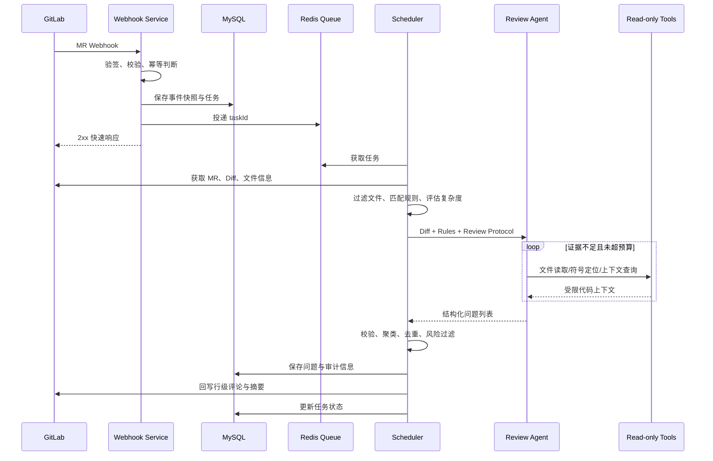
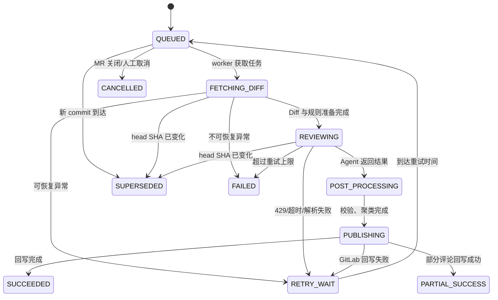

# CodeLens Agent 业务逻辑说明

本文描述 CodeLens Agent 从 GitLab Merge Request 事件进入系统，到 AI 审查结果回写及人工反馈沉淀的完整业务逻辑。

## 1. 业务目标与边界

### 1.1 业务目标

1. 自动发现 MR 中具备明确位置、证据和影响的代码问题；
2. 将团队规范转化为稳定、可复用的仓库级审查能力；
3. 在保证审查质量的同时控制响应时间和模型成本；
4. 通过人工反馈识别 Bad Case，持续治理误报和无效建议。

### 1.2 系统边界

平台负责：

- 接收 GitLab Webhook；
- 获取 MR 元数据、Diff 和必要的只读代码上下文；
- 匹配审查规则并调度模型；
- 生成、治理、存储和回写问题；
- 收集人工反馈并形成可回归的 Bad Case。

平台不负责：

- 自动修改或合并代码；
- 执行仓库内脚本或不可信命令；
- 替代编译、单元测试、SAST 等确定性质量门禁；
- 在证据不足时给出确定性结论。

## 2. 参与者

| 参与者 | 职责 |
| --- | --- |
| GitLab | 产生 MR 事件，提供 Diff/文件 API，承载审查评论 |
| 开发者 | 提交 MR，查看并确认问题，修复代码 |
| 项目管理员 | 配置仓库、审查规则、分支范围和模型策略 |
| Webhook 服务 | 验签、解析、去重并快速创建任务 |
| 调度器 | 管理队列、优先级、模型路由、重试和降级 |
| Review Agent | 分析 Diff、调用工具取证、输出结构化问题 |
| 反馈治理模块 | 聚类去重、收集人工反馈、沉淀 Bad Case |

## 3. 领域模型

### 3.1 Repository（仓库）

记录 GitLab 项目标识、接入状态、默认分支、凭据引用和默认审查策略。凭据只保存安全存储中的引用，不在业务表中保存明文 Token。

### 3.2 ReviewRule（审查规则）

规则可以按以下维度匹配：

- 仓库；
- 源分支/目标分支；
- 文件路径（如 `src/main/**`）；
- 文件语言；
- 规则优先级和启停状态。

当多个规则同时命中时，按“更具体范围优先、显式优先级其次、仓库默认规则兜底”的顺序合并。同一规则标识发生冲突时只保留优先级最高的版本。

### 3.3 ReviewTask（审查任务）

一个任务对应某个 MR 的一个确定 commit 版本。推荐幂等键：

```text
{gitlabProjectId}:{mrIid}:{headCommitSha}
```

相同幂等键只能存在一个有效任务；MR 推送新 commit 后，应将旧版本尚未执行的任务标记为 `SUPERSEDED`，避免把过期结论回写到最新代码。

### 3.4 ReviewIssue（审查问题）

一个有效问题至少包含：

```json
{
  "ruleId": "CONCURRENCY-001",
  "severity": "CRITICAL",
  "title": "非原子更新可能导致库存超卖",
  "filePath": "src/main/java/.../StockService.java",
  "startLine": 86,
  "endLine": 93,
  "evidence": "读取库存与扣减操作之间没有锁或条件更新",
  "impact": "并发请求可能同时通过库存校验",
  "suggestion": "使用带库存条件的原子 UPDATE，并校验受影响行数",
  "confidence": 0.91
}
```

缺少文件定位、代码证据或明确影响的问题不能作为行级问题直接回写，可降级为低置信度汇总建议或直接过滤。

### 3.5 ReviewFeedback（人工反馈）

反馈建议使用以下类型：

- `ACCEPTED`：问题成立并采纳；
- `REJECTED_FALSE_POSITIVE`：误报；
- `REJECTED_NOT_RELEVANT`：成立但与当前 MR 无关；
- `IGNORED_DUPLICATE`：重复问题；
- `FIXED`：已修复并可在新 commit 中验证。

## 4. 主流程



### 4.1 Webhook 接入

处理顺序：

1. 校验请求 Secret/签名和来源；
2. 只接受配置范围内的 MR 事件；
3. 提取项目、MR、分支、head SHA、事件动作等字段；
4. 检查仓库是否启用、目标分支是否需要审查；
5. 基于幂等键查询是否已经处理；
6. 在同一事务中创建事件记录与任务记录；
7. 事务提交后投递队列；
8. 尽快响应 GitLab，不在 Webhook 请求线程中调用模型。

推荐关注的 MR 动作：

- `open` / `reopen`：创建审查任务；
- `update` 且 head SHA 变化：创建新版本任务；
- `merge` / `close`：取消未执行任务，不再发起审查；
- 仅标题、描述等元数据变化：默认不重复审查。

### 4.2 Diff 获取与预处理

获取 MR Diff 后，依次执行：

1. 校验任务的 head SHA 仍然是当前版本；
2. 规范化文件路径和换行符；
3. 过滤二进制文件、锁文件、压缩文件、自动生成文件和管理员配置的忽略路径；
4. 对超大文件或超长 Diff 截断并记录原因；
5. 按文件拆分变更块（hunk），保留新旧行号映射；
6. 识别语言并加载对应规则；
7. 计算任务复杂度。

### 4.3 复杂度评估与模型路由

推荐使用可解释的评分，而不是完全依赖模型自行判断：

```text
complexityScore =
  changedLinesWeight
  + changedFilesWeight
  + languageRiskWeight
  + criticalPathWeight
  + contextDependencyWeight
```

可将任务分为三层：

| 层级 | 特征 | 路由策略 |
| --- | --- | --- |
| LOW | 少量文件、局部逻辑、上下文依赖低 | 快速/低成本模型，较小 Tool Call 预算 |
| MEDIUM | 跨多个文件或包含业务逻辑修改 | 主力模型，标准 Tool Call 预算 |
| HIGH | 核心链路、并发/事务/权限变更、上下文依赖高 | 高能力模型，更完整上下文，可分批审查 |

复杂度路由只影响模型与预算，不降低安全、权限和数据一致性类规则的优先级。

### 4.4 规则匹配

规则匹配输入包括：

- repositoryId；
- sourceBranch / targetBranch；
- filePath；
- language；
- MR 标签或项目级开关。

输出由“通用规则 + 语言规则 + 仓库规则 + 路径规则”组成。规则内容应尽量包含：检查目标、触发条件、反例、允许例外和问题等级，避免只有模糊口号。

### 4.5 Agent 审查与主动取证

Agent 对每个变更块执行“发现疑点 → 判断证据是否充分 → 调用工具 → 形成结论”的循环。

工具建议：

| 工具 | 输入 | 输出 | 限制 |
| --- | --- | --- | --- |
| `read_file` | commit、path、行范围 | 指定代码片段 | 限制文件大小与最大行数 |
| `find_symbol` | commit、symbol | 定义和引用位置 | 只允许当前仓库 |
| `search_context` | commit、关键词/模式 | 命中位置及邻近内容 | 限制命中条数 |

停止调用工具的条件：

- 已获得能够支持或排除问题的证据；
- 达到单任务 Tool Call 次数或 Token 上限；
- 连续调用没有新增信息；
- 请求超时或下游服务不可用。

达到预算但证据仍不足时，Agent 必须放弃确定性问题或降低置信度，不能根据猜测补全事实。

### 4.6 固定输出协议

模型输出应通过 JSON Schema 约束，核心字段包括：

- 规则标识和严重等级；
- 文件路径与新版本行号；
- 简短标题；
- 与本次变更直接相关的代码证据；
- 可验证的影响；
- 能够执行的修复建议；
- 置信度。

输出处理顺序：

1. JSON/Schema 校验；
2. 文件路径与行号合法性校验；
3. 确认问题落在本次变更行或与变更强相关；
4. 过滤无证据、泛化或纯风格偏好问题；
5. 进入问题聚类与去重。

### 4.7 二次聚类与去重

去重键可由以下特征组成：

```text
filePath + lineRange + ruleId + semanticFingerprint
```

聚类规则：

- 同一文件相邻行、同一根因的问题合并；
- 多个表现由同一处代码引起时保留影响最完整的问题；
- 严重等级冲突时，选择有充分证据支持的最高等级，而非机械取最高值；
- 修复建议互相冲突时不自动合并，标记为待人工复核；
- 已在同一 MR 旧 commit 评论过且未发生相关代码变化的问题不重复发布。

### 4.8 GitLab 回写

回写优先级：

1. 能映射到 Diff 新行：发布行级 Discussion；
2. 只能定位文件或旧行：写入汇总评论；
3. 全局风险或审查不完整：在摘要中说明，不伪造行号。

摘要建议包含：

- 本次审查覆盖范围；
- 各等级问题数量；
- 被过滤或跳过的文件及原因；
- 审查是否发生降级；
- 任务 ID 和人工反馈入口。

所有评论都要携带稳定的问题指纹，便于更新、去重和反馈关联。

## 5. 任务状态机



终态：`SUCCEEDED`、`PARTIAL_SUCCESS`、`FAILED`、`CANCELLED`、`SUPERSEDED`。

## 6. 排队位次与预计等待时间

队列页面至少展示：

- 当前状态；
- 排队位次；
- 预计开始时间或等待时长；
- 已完成阶段；
- 降级或失败原因。

推荐估算方式：

```text
estimatedWait =
  sum(前序任务的预估处理时长) / 当前可用并发 worker 数
```

预估处理时长可使用“复杂度等级 + 最近一段时间同等级任务 P50/P75 耗时”计算。由于模型限流和任务动态变化，UI 应明确标注这是估算值，并定期刷新而非承诺精确时间。

## 7. 重试与降级

### 7.1 重试原则

仅对暂时性故障重试，并设置次数上限。每次重试都记录 `attempt`、错误类型、下次执行时间和已消耗预算。

| 错误 | 是否重试 | 推荐策略 |
| --- | --- | --- |
| LLM 429 | 是 | 指数退避 + 抖动，必要时切备用模型 |
| LLM 5xx | 是 | 有限重试，连续失败后降级 |
| LLM 超时 | 是 | 缩小批次或上下文后重试一次 |
| 输出解析失败 | 有条件 | 协议修复一次，仍失败则降级 |
| GitLab 401/403 | 否 | 终止并提示凭据/权限问题 |
| GitLab 404 | 否 | 确认 MR/项目已删除后终止 |
| 网络暂时异常 | 是 | 指数退避 |

### 7.2 降级顺序

1. 减少非关键上下文和 Tool Call 次数；
2. 将大型任务拆分为文件批次；
3. 切换备用模型；
4. 仅执行高风险规则；
5. 返回已完成的部分结果并标记 `PARTIAL_SUCCESS`。

降级不能静默发生。结果摘要必须说明未覆盖的文件、规则或上下文。

## 8. 人工确认与 Bad Case 闭环

人工确认的核心不是简单记录“赞/踩”，而是形成可定位、可复现的样本。

Bad Case 至少保存：

- 脱敏后的 Diff 和必要上下文快照；
- 当时命中的规则版本；
- 模型、Prompt 和工具调用链版本；
- 原始输出和治理后的最终问题；
- 人工判定及原因；
- 问题指纹和发生时间。

治理流程：

1. 将 `REJECTED_FALSE_POSITIVE`、重复问题和高频忽略项加入候选集；
2. 按规则、仓库、语言和根因聚类；
3. 由维护者确认是规则问题、Prompt 问题、上下文不足还是模型能力问题；
4. 调整规则或 Prompt 后在离线样本集回放；
5. 新版本指标不退化后再上线；
6. 保留版本号，保证线上问题可追溯。

## 9. 推荐数据表

| 表名 | 关键字段 |
| --- | --- |
| `repository` | `id`, `gitlab_project_id`, `name`, `status`, `default_branch`, `credential_ref` |
| `review_rule` | `id`, `repository_id`, `rule_key`, `scope`, `severity`, `content`, `version`, `enabled` |
| `webhook_event` | `id`, `event_uuid`, `event_type`, `payload_digest`, `received_at`, `status` |
| `review_task` | `id`, `idempotency_key`, `project_id`, `mr_iid`, `head_sha`, `status`, `complexity`, `attempt`, `queued_at`, `finished_at` |
| `review_issue` | `id`, `task_id`, `fingerprint`, `rule_id`, `severity`, `file_path`, `start_line`, `evidence`, `suggestion`, `confidence` |
| `tool_call_log` | `id`, `task_id`, `tool_name`, `request_digest`, `result_digest`, `duration_ms`, `status` |
| `review_feedback` | `id`, `issue_id`, `feedback_type`, `reason`, `operator_id`, `created_at` |
| `bad_case` | `id`, `issue_id`, `category`, `snapshot_ref`, `rule_version`, `prompt_version`, `resolution` |

建议对 `review_task.idempotency_key` 和 `review_issue.fingerprint` 建立唯一索引或范围唯一约束。

## 10. 安全逻辑

- GitLab Webhook 必须验签或校验 Secret，并限制请求体大小；
- GitLab Token 和模型 Key 使用密钥管理，不写入日志和数据库明文字段；
- Agent 读取范围固定在当前项目、当前 commit；
- 工具参数采用白名单校验，拒绝 `../`、绝对路径和跨仓库引用；
- 仓库文本属于不可信输入，代码注释中的“忽略之前指令”等内容不能改变系统策略；
- 回写评论前再次验证项目、MR 和 head SHA，避免跨项目或过期回写；
- 对用户、项目和模型分别限流，防止单一仓库占满系统资源；
- 日志和 Bad Case 对密钥、个人信息和业务敏感内容进行脱敏。

## 11. 验收指标

### 11.1 功能指标

- 同一 commit 的重复 Webhook 不产生重复审查；
- 新 commit 到达后，旧任务不会向新版本错误回写；
- 每个行级问题均可定位到有效 Diff 行；
- 人工反馈可关联到唯一问题和对应审查版本；
- 可恢复异常进入有限重试，不可恢复异常给出明确原因。

### 11.2 质量与性能指标

- 平均首次反馈时间小于 8 分钟；
- 人工确认有效问题采纳率达到 80%；
- 任务成功率、P95 审查耗时和回写成功率持续可观测；
- 按仓库、规则和模型版本跟踪误报率；
- 429、超时和解析失败均有独立指标与告警。

## 12. 推荐模块划分

```text
codelens-agent
├── webhook          # GitLab Webhook 接入、验签、事件解析
├── repository       # 仓库配置与凭据引用
├── rule             # 规则配置、匹配与版本管理
├── review-task      # 任务、状态机、幂等与进度查询
├── scheduler        # 队列消费、优先级、模型路由、重试降级
├── gitlab-client    # MR、Diff、文件读取和评论回写
├── agent            # Prompt、模型调用、Tool Calling 与协议解析
├── tool             # 受限的文件/符号/上下文只读工具
├── issue            # 问题校验、聚类、去重和指纹
├── feedback         # 人工确认与 Bad Case 管理
└── observability    # 指标、日志、链路追踪和审计
```

该划分可以先部署为模块化单体；当模型调用、队列消费或 GitLab 回写出现独立扩缩容需求时，再按边界拆分服务，避免过早引入分布式复杂度。

