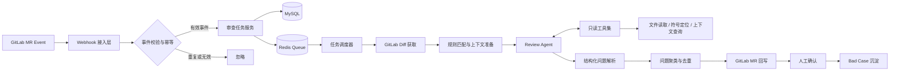

# CodeLens Agent

<<<<<<< HEAD
基于简历技术栈和业务逻辑的模块化单体 MVP：Java 21、Spring Boot、MySQL、Redis、DeepSeek/LangChain4j 接入位、GitLab Webhook、异步队列、幂等任务与有限重试。

## 启动

1. `docker compose up -d`
2. 设置 `DEEPSEEK_API_KEY` 与 `GITLAB_WEBHOOK_SECRET`
3. `mvn spring-boot:run`
4. GitLab MR Webhook 指向 `POST /api/webhooks/gitlab`，请求头 `X-Gitlab-Token` 必须匹配 Secret。

当前 Worker 已完成任务状态流转骨架；GitLab Diff、只读工具、LangChain4j 结构化输出和评论回写应在 `service` 边界继续接入，避免把不可信仓库内容当作系统指令。
=======
基于大模型 Agent 的 GitLab Merge Request 智能代码审查平台。平台接收 GitLab MR Webhook，异步拉取代码差异并关联仓库级规范，通过工具增强的审查 Agent 主动补充上下文，最终将分级问题与修复建议回写到 MR，帮助研发团队更早发现缺陷并统一代码审查标准。

> 项目定位：AI Code Review Platform / 核心开发项目

## 项目背景

传统人工 Code Review 容易受到审查时间、个人经验和上下文缺失的影响，常见问题包括：

- 大型 MR 审查成本高，反馈周期长；
- 团队规范分散，审查标准难以统一；
- 仅查看 Diff 容易产生误报，无法判断符号定义、调用链和项目约束；
- 大模型输出不稳定，可能出现重复问题、格式错误或缺少有效证据；
- 高并发时受模型限流和超时影响，审查任务的可用性难以保证。

CodeLens Agent 将 GitLab、规则引擎、任务队列和具备 Tool Calling 能力的 Agent 串联起来，形成从 MR 触发、上下文检索、问题识别到人工确认的完整闭环。

## 核心能力

- **Webhook 自动触发**：接收 GitLab MR 创建、更新等事件，自动生成审查任务。
- **仓库级规则匹配**：根据项目、分支、文件路径和语言匹配对应的审查规范。
- **异步审查流水线**：异步获取 Diff、拆分文件、调度模型并回写结果，避免阻塞 Webhook 请求。
- **Agent 主动取证**：提供文件读取、符号定位和上下文查询等只读工具，让 Agent 围绕可疑变更补充证据。
- **结构化问题输出**：通过固定协议输出问题位置、严重等级、证据、影响和修复建议。
- **结果治理**：使用二次聚类合并重复问题，并通过人工确认沉淀 Bad Case，持续降低误报。
- **弹性与降级**：针对 429、模型超时和 Tool Call 解析失败进行有限重试、模型降级或跳过非关键步骤。
- **进度可见**：向用户展示排队位次和预计等待时间，改善高峰期使用体验。

## 技术栈

| 分类 | 技术 |
| --- | --- |
| 服务端 | Java、Spring Boot |
| Agent / LLM | DeepSeek、LangChain4j、Tool Calling |
| 代码平台 | GitLab API、GitLab Webhook |
| 数据存储 | MySQL |
| 缓存与队列 | Redis |
| 部署 | Docker |

## 系统架构



## 核心业务流程

1. **接收事件**：GitLab 在 MR 创建或提交更新时发送 Webhook。
2. **校验与幂等**：校验请求来源、事件类型和关键字段，以 `projectId + mrIid + commitSha` 作为幂等维度，避免同一版本重复审查。
3. **创建任务**：持久化 MR 快照和审查任务，将任务写入队列，并立即向 GitLab 返回成功响应。
4. **任务排队**：根据任务复杂度、租户/项目优先级和可用模型容量进行调度，同时计算排队位次及预计等待时间。
5. **获取变更**：调用 GitLab API 获取 MR Diff、文件列表和基础元数据，过滤二进制文件、生成文件和超大文件。
6. **匹配规范**：按仓库、目标分支、文件路径和编程语言组合匹配审查规则。
7. **复杂度评估**：综合变更文件数、Diff 行数、语言类型和上下文需求，将任务路由到不同能力或成本的模型。
8. **Agent 审查**：Agent 先分析 Diff；证据不足时调用只读工具读取相关文件、定位符号或查询上下文，再生成结构化问题。
9. **结果治理**：校验输出协议，过滤无定位或无证据的问题，对语义相近问题进行二次聚类和合并。
10. **回写 MR**：优先以行级评论回写；无法精确定位时生成 MR 汇总评论，并附带严重等级、证据和修复建议。
11. **人工确认**：开发者对问题执行采纳、驳回或忽略，系统记录反馈并沉淀误报 Bad Case。

详细规则、状态机、异常分支和数据模型见 [BUSINESS_LOGIC.md](./BUSINESS_LOGIC.md)。

## 问题分级

| 等级 | 含义 | 示例 | 建议处理方式 |
| --- | --- | --- | --- |
| Blocker | 可能造成严重安全、数据或可用性事故 | 权限绕过、数据破坏、确定性崩溃 | 合并前必须修复 |
| Critical | 高概率引发生产故障或核心逻辑错误 | 并发竞态、事务错误、资源泄漏 | 合并前优先修复 |
| Major | 影响功能正确性、性能或可维护性 | 边界条件遗漏、明显 N+1 查询 | 建议本次修复 |
| Minor | 低风险质量问题 | 局部可读性、轻微重复实现 | 可评估后处理 |
| Suggestion | 非阻断优化建议 | 命名、抽象或测试补充 | 自主采纳 |

## Agent 工具约束

为降低越权和提示词注入风险，Agent 工具遵循以下原则：

- 所有工具默认只读，不允许修改仓库、执行任意命令或访问审查范围外的数据；
- 文件路径必须归属于当前项目和指定 commit，不接受路径穿越；
- 单次调用限制返回行数、文件大小和总 Token，防止上下文失控；
- 工具参数、结果和耗时均记录审计日志；
- 仓库代码和注释仅作为待审查数据，不作为系统指令执行。

## 可靠性设计

| 场景 | 处理策略 |
| --- | --- |
| 模型返回 429 | 指数退避并加入随机抖动；超过阈值后切换备用模型或延迟重试 |
| 模型调用超时 | 按阶段设置超时；有限重试后降级为轻量审查或部分结果 |
| Tool Call 解析失败 | 尝试协议修复；仍失败则回退到纯 Diff 审查并标记结果置信度 |
| GitLab API 失败 | 对可恢复错误重试；权限或资源不存在时终止并记录明确原因 |
| 输出格式错误 | 使用 JSON Schema 校验并触发一次结构化修复，禁止无限重试 |
| 回写失败 | 审查结果先落库，通过独立回写任务补偿，保证结果不丢失 |
| 重复 Webhook | 幂等键去重；新 commit 到达时取消旧版本待执行任务 |

## 核心数据对象

- `repository`：GitLab 项目及接入配置；
- `review_rule`：仓库、路径、语言或分支维度的审查规则；
- `review_task`：一次 MR commit 版本对应的审查任务；
- `review_issue`：Agent 发现的结构化问题；
- `tool_call_log`：工具调用审计记录；
- `review_feedback`：人工采纳、驳回及原因；
- `bad_case`：用于规则优化和回归评测的误报/漏报样本。

## API 示例（推荐设计）

```text
POST /api/webhooks/gitlab                 # 接收 GitLab Webhook
GET  /api/reviews/{taskId}                # 查询任务状态与进度
GET  /api/reviews/{taskId}/issues         # 查询审查问题
POST /api/reviews/{taskId}/cancel         # 取消未完成任务
POST /api/issues/{issueId}/feedback       # 提交人工确认结果
GET  /api/repositories/{id}/rules         # 查询仓库规则
POST /api/repositories/{id}/rules         # 新增仓库规则
```

## 配置示例

```yaml
spring:
  datasource:
    url: jdbc:mysql://mysql:3306/codelens
    username: ${DB_USERNAME}
    password: ${DB_PASSWORD}
  data:
    redis:
      host: redis
      port: 6379

codelens:
  gitlab:
    base-url: ${GITLAB_BASE_URL}
    token: ${GITLAB_TOKEN}
    webhook-secret: ${GITLAB_WEBHOOK_SECRET}
  llm:
    primary-model: ${PRIMARY_MODEL}
    fallback-model: ${FALLBACK_MODEL}
    api-key: ${LLM_API_KEY}
  review:
    max-retry: 3
    task-timeout: 10m
    max-tool-calls: 12
```

> 请勿将 GitLab Token、模型 API Key 或 Webhook Secret 提交到仓库。

## 本地运行（参考）

```bash
git clone <repository-url>
cd codelens-agent
cp .env.example .env
docker compose up -d
```

启动后可通过健康检查确认服务状态：

```bash
curl http://localhost:8080/actuator/health
```

## 项目效果

- 累计完成 **100+ 个 MR** 的智能审查；
- 平均首次反馈时间控制在 **8 分钟以内**；
- 经人工确认的有效问题采纳率达到 **80%**。

## 可观测性指标

建议持续监控以下指标：

- Webhook 接收量、验签失败数和幂等命中率；
- 队列长度、任务等待时间、端到端耗时和任务成功率；
- 不同模型的调用量、Token 消耗、429 比例和超时率；
- Tool Call 次数、失败率和平均耗时；
- 问题数量、各等级分布、回写成功率和人工采纳率；
- 按仓库、语言和规则维度统计的误报率。

## 后续规划

- 增加增量审查，只分析新旧 commit 之间的新增变更；
- 引入规则与 Bad Case 的离线评测集，支持模型/Prompt 回归测试；
- 补充调用链、依赖关系和测试覆盖率等更丰富的代码上下文；
- 支持审查预算、Token 配额和多租户限流；
- 建立基于人工反馈的规则权重与置信度校准机制。

>>>>>>> d6dc1034283cf77457651501cac4b668e99a3e20
